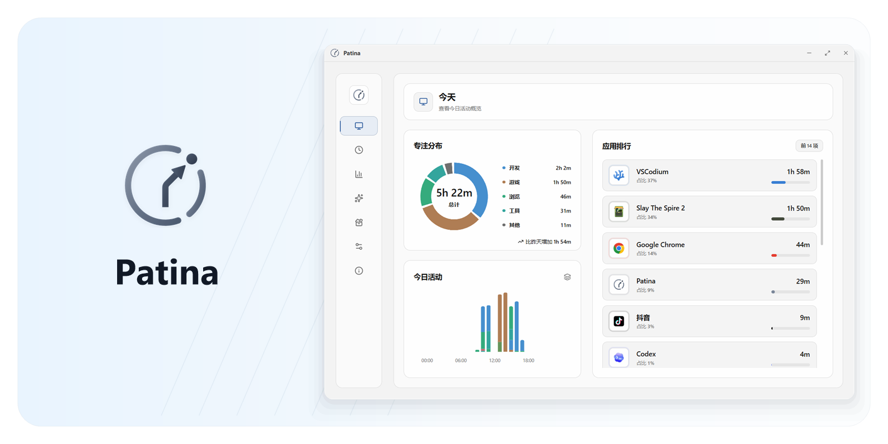
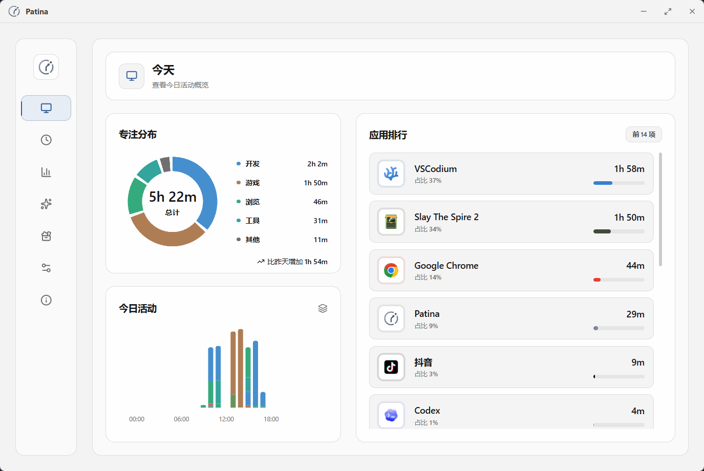
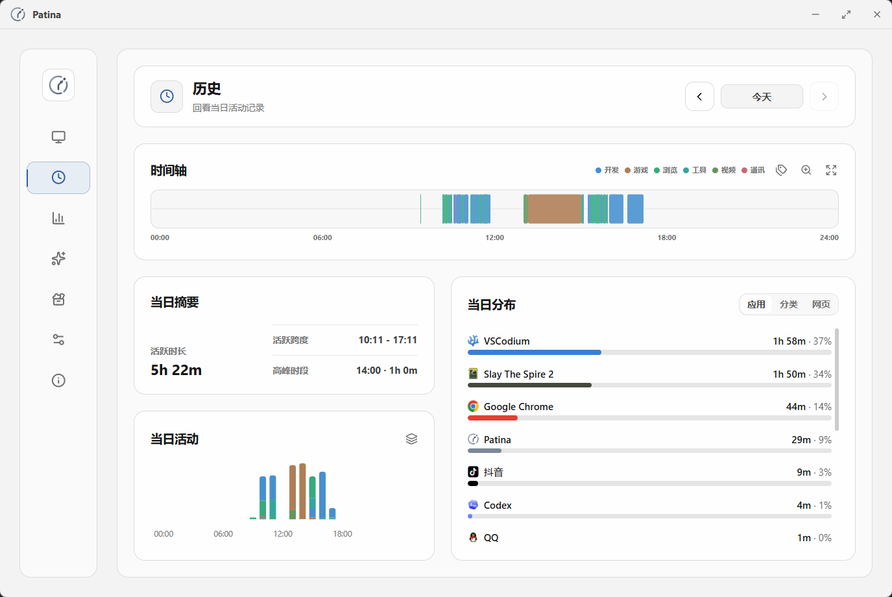
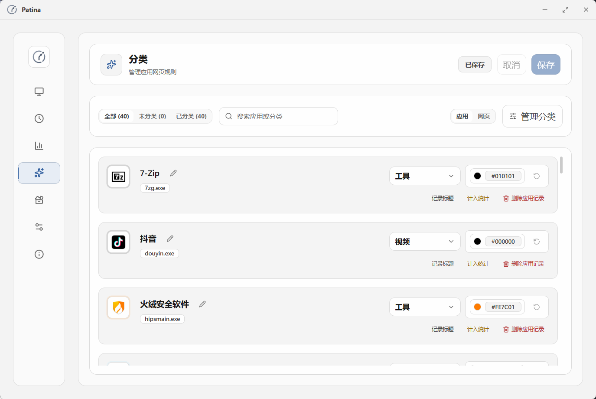
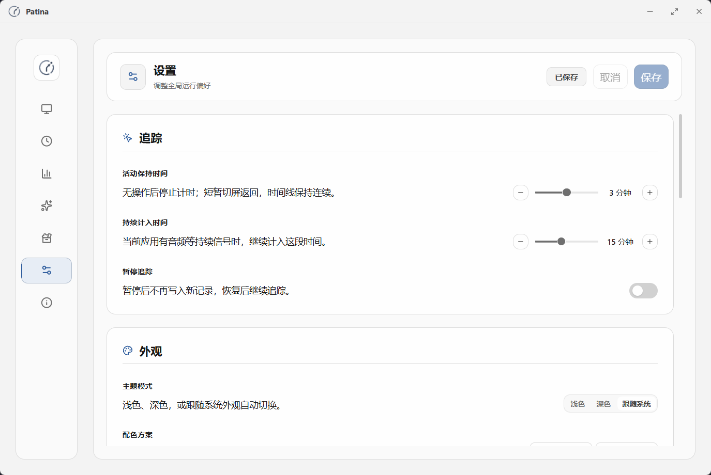
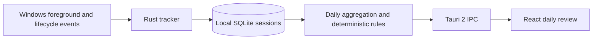

# FocusLedger

> 基于真实 Windows 前台活动记录的本地优先（Local-first）个人效率复盘系统。

## 项目截图

以下图片来自仓库中已有的真实项目界面素材，统一存放在 `.github/assets/readme.zh-CN/`。截图展示的是实际可运行的界面；由于项目保留 Patina 的内部兼容标识，部分窗口标题仍可能显示 `Patina`。



*界面概览：从一个入口查看当天的时间分布、应用排行和活动概览。*



*日报主界面：把前台应用会话整理成分类分布和应用用时，便于快速回顾一天的活动。*



*History：沿时间轴查看当天各应用会话及其时间区间，帮助定位行为发生的具体时段。*



*分类管理：按可执行文件维护应用分类，为后续统计提供透明、可调整的分类依据。*



*Settings：管理追踪行为、外观和本地数据相关选项，应用运行不需要账号或云端服务。*

## 项目简介

FocusLedger 是基于 [Patina](https://github.com/Ceceliaee/patina) 二次开发的 Windows 桌面生产力分析工具。它保留上游的 Windows 前台窗口采集能力，将事件形成的活动会话写入本机 SQLite，再在本地生成日报、时间分布、应用分类占比和可解释的行为发现。

项目的重点是把“发生了什么”呈现为可复核的证据：每条规则发现都带有 evidence interval（证据区间），Activity Score 使用公开公式计算，规则分析由 deterministic rule engine（确定性规则引擎）完成。它描述可观测的活动覆盖情况，不把结果包装成对生产力、专注程度或个人价值的判断。

FocusLedger 运行在单机 Windows 环境，不依赖云端、账号或 AI API。采集、SQLite 存储、分析和界面展示均在本机完成。

## 核心功能

- **Windows 前台活动采集**：保留 Patina 的 Rust 采集链路和会话生命周期处理。
- **每日使用统计**：按本地日期计算前台工作时间、推断空闲、未观测时间、应用排行和分类占比。
- **Explainable Activity Score**：`floor(工作时间 / (工作时间 + 推断空闲) × 100)`；没有观测数据时不显示分数。
- **行为发现**：检测高频应用切换、长时间连续活动和长时间空闲，并返回对应时间范围与证据数量。
- **Demo 日报**：首次启动展示带明确标识的合成完整日，使用同一分析引擎，不写入真实 SQLite 数据。
- **真实数据切换**：可在 Demo 与本机实际采集记录之间切换，选择保存在本机。
- **本地工具**：保留历史时间轴、应用分类、数据管理和本地备份/恢复等上游能力。

## 技术栈

- **Desktop**：Tauri 2、Rust、Windows API crate
- **Frontend**：React 19、TypeScript、Vite、Tailwind CSS 4、`lucide-react`
- **Storage**：SQLite、`sqlx`、版本化 migration
- **Build & test**：Node.js 24、pnpm 12、Rust toolchain、TypeScript tests、Rust tests、browser smoke tests

技术栈以仓库中的 `package.json`、`src-tauri/Cargo.toml` 和 `rust-toolchain.toml` 为准。项目没有接入云数据库、账号系统或 AI 服务。

## 核心设计 / 架构



1. Windows 前台窗口和生命周期事件由 Rust tracker 形成 session 记录。
2. session 事实写入本机 SQLite；日报请求只读取所选日期范围内的重叠记录。
3. Rust daily-review owner 裁剪跨日和当前时刻、去除重叠、按应用和分类聚合，并运行规则引擎。
4. Tauri 2 IPC 返回只读 DTO；React 负责日期切换、展示和数据校验，派生报表按需计算，不重复落库。
5. 第 17 版 migration 新增单例表 `daily_review_rules` 保存规则阈值，不改写既有 session 事实。

主要边界和数据流见[架构说明](docs/focusledger/architecture.md)。

## 隐私与安全

- 所有活动记录和日报分析默认留在本机 SQLite；不需要账号、云同步或远程服务。
- 后端固定拒绝远程更新、WebDAV 和远程状态连接，已有设置也不能重新启用网络传输。
- 可选的浏览器活动桥只监听本机 loopback；日报只分析原生 Windows 前台 session。
- Demo 数据在 Rust 内存中生成，不写入、删除或替换真实记录。
- 本地数据库默认路径为 `%APPDATA%\\Patina\\patina.db`；开发环境使用 `%APPDATA%\\Patina Dev\\patina.db`。实际路径可在 Settings 查看。
- `.gitignore` 排除 `.env`、密钥、证书、数据库、日志、缓存和构建产物；仓库不应提交真实用户活动记录。

依赖安装和编译可能需要开发机联网；应用本身的采集、分析和本地备份可以离线运行。

## Demo 与真实数据说明

首次启动默认进入 Daily review，并展示带“演示数据”标识的合成完整日：包含五个应用、分类分布和三类规则发现。Demo 由 Rust 在内存中生成，使用固定默认阈值和同一 `analyze_day` 分析路径，不读取或改变 SQLite、迁移状态和系统采集状态。

演示中的完整一天可能包含当天尚未发生的未来时段，因此只能用于展示交互和分析结果，不能当作真实行为证据。选择“查看真实记录”后，日报只读取本机已经采集的 session；没有记录时显示空状态，不会静默回退到 Demo。两个模式都支持日期切换和刷新。

## 本地运行

### 环境要求

- Windows 10/11
- WebView2 Runtime
- Visual Studio C++ Build Tools
- `rust-toolchain.toml` 指定的 Rust toolchain
- `package.json` 指定的 Node.js 24 和 pnpm 12.3.4

### 开发运行

```powershell
pnpm install --frozen-lockfile
pnpm run tauri dev
```

### 构建

```powershell
# 生成可直接运行的 Windows executable
pnpm run tauri build --no-bundle

# 生成 NSIS installer
pnpm run tauri build --bundles nsis
```

前者输出 `src-tauri/target/release/FocusLedger.exe`，后者输出 `src-tauri/target/release/bundle/nsis/` 下的安装包。前端资源会嵌入 executable，运行时不需要开发服务器。

### 测试与检查

```powershell
pnpm run test:daily-review
pnpm run test:ui-browser-smoke --daily-review-only
pnpm run test:tauri-runtime-smoke --daily-review-only
pnpm run check:types
pnpm run check:lint
pnpm run check:i18n
pnpm run check:ipc-contracts
pnpm run check:architecture
pnpm run check:rust-boundaries
pnpm run build
cargo fmt --manifest-path src-tauri/Cargo.toml --all -- --check
cargo test --manifest-path src-tauri/Cargo.toml --locked --lib
```

测试覆盖 Activity Score、空数据、规则阈值和 evidence intervals、跨日裁剪、活动中的 session、重叠去重、migration 幂等与约束，以及异常 IPC payload。上游 tracker、storage 和 restore 测试仍然保留。

## 项目结构

```text
src/                         React frontend、页面和 IPC gateway
src-tauri/src/               Rust backend、Windows tracker、SQLite 和 Tauri commands
src-tauri/src/data/schema.rs SQLite versioned migrations
tests/                       TypeScript、browser smoke 和 runtime tests
docs/focusledger/            架构、数据定义和限制说明
.github/assets/readme.zh-CN/ README 使用的真实 UI 截图
```

日报相关代码的主要职责如下：

- `src-tauri/src/data/daily_review.rs`：SQL 读取、聚合和规则分析
- `src-tauri/src/commands/daily_review.rs`：Tauri IPC 边界和错误映射
- `src/platform/persistence/dailyReviewGateway.ts`：IPC payload 校验
- `src/features/daily-review/components/DailyReview.tsx`：日期导航和界面展示
- `src-tauri/src/data/schema.rs`：版本化 SQLite migration

## 当前限制 / 已知边界

- **idle 是推断值**：当前根据事件形成的前台 session 之间的间隔推断 idle，不是 Windows 直接测得的输入空闲。停采、锁屏和睡眠也可能造成间隔；前台 session 本身也不代表用户一直有输入。
- **Windows Idle API 尚未接入**：未来可结合 `GetLastInputInfo`、session 和 power events 提供更直接的输入空闲证据；这不属于当前 MVP。
- **工作时间不是生产性工作时间**：所有应用类别都会计入前台活动，娱乐应用同样会计入；连续活动也不等同于已证明的专注。
- **分类采用透明映射**：日报使用小型 executable-name map；未知应用归入 `Other`，它与用户自定义分类设置是两个独立机制。
- **Activity Score 的含义有限**：它反映“前台活动 + 推断长间隔”的覆盖比例，不衡量效率、专注、任务完成度、健康或员工表现。
- **Windows only**：当前不承诺 macOS、Linux 或移动端支持。

更多规则语义、迁移边界和离线策略见[架构说明](docs/focusledger/architecture.md)；发布验证证据见[release validation report](docs/working/focusledger-release-validation.md)。

## License

本项目基于 Patina 二次开发，遵循 [MIT License](LICENSE)，并保留上游版权和署名信息。展示项目时应明确区分 Patina 的原有采集能力与 FocusLedger 新增的本地分析、规则引擎和日报工作。
