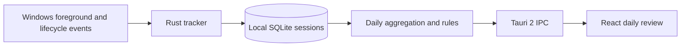

# FocusLedger Architecture

## Scope

FocusLedger is a Windows-only personal activity review application derived from Patina. It retains the upstream foreground-window tracker and its session lifecycle, Tauri 2 desktop shell, Rust backend, React frontend, and SQLite database. Daily analysis runs locally and makes no AI API or cloud-service calls.

## Daily review flow

1. The React daily review view computes the selected local calendar day's UTC epoch boundaries, including daylight-saving transitions.
2. A narrow Tauri command validates the requested range and reads overlapping rows from the native `sessions` table.
3. The Rust daily-review owner clips sessions to the day and the current instant, removes overlaps, totals foreground time by app, applies the deterministic category map and evaluates switching, continuous-work and long-gap rules. Earlier sessions own overlapping time so recovered records cannot inflate totals.
4. The command returns a read-only DTO. Derived reports are calculated on demand and are not duplicated in storage.

The migration at schema version 17 creates `daily_review_rules`, a local singleton containing the thresholds used by the rule engine. Defaults are 12 application transitions in 30 minutes, 90 minutes of continuous activity and a 20-minute idle gap. Checks constrain values to supported ranges. Reapplying the table setup preserves existing thresholds. The normal migration runner advances the database version without replacing sessions.

## Metrics and interpretation

### Demonstration and first launch

Without a saved view, the shell opens Daily review. The default source is a labeled Demo, with a persisted local switch to real records. The optional `demo` IPC argument defaults to false for existing callers. Demo is generated in Rust memory before pool acquisition and uses the same `analyze_day` owner with fixed default thresholds. It does not read or write SQLite, change tracking, or alter migration state. No demo schema or migration is needed.

The synthetic full day uses offsets from the selected local day's epoch start, includes five apps and all three rule types, and deliberately includes future hours when showing today. On daylight-saving transitions these fixed offsets can shift the displayed clock hour. Only real reports are clipped to the current instant. The UI always labels the chosen source; real data is never silently replaced with Demo after an empty result or a load failure.

### Real activity

- Work time is the sum of clipped foreground session intervals.
- A session gap at or above the configured idle threshold is shown as inferred idle. It is not an OS-measured idle interval. Shorter gaps and time outside recorded sessions are counted as unobserved.
- Activity Score (`activityScore` in IPC) is `work / (work + inferred idle) * 100`, rounded down. It describes only recorded activity and inferred long gaps; it does not measure productivity, concentration, employee performance, health, or personal worth.
- App categories are assigned by a small transparent executable-name map (`Productivity`, `Browser`, `Communication`, `Entertainment`, `Other`). Unknown apps remain `Other`.
- Frequent switching is a sliding-window transition count; repeated sessions of the same executable do not count as switches. A gap greater than two minutes resets the window. Each emitted finding covers the full sessions participating in those transitions, so its displayed span can exceed the transition window. The counter resets after a finding to avoid repeatedly reporting the same transitions.
- Continuous work joins foreground sessions separated by at most two minutes. Long idle detects long gaps between foreground sessions. Findings carry their exact interval and evidence count. Continuous activity can include switches and should not be interpreted as proven concentration.
- Today's distribution covers elapsed time only; future hours are excluded. An empty day has no score. The IPC validator checks numeric ranges, totals, application durations and finding boundaries before rendering.

## Boundaries

- `src-tauri/src/data/daily_review.rs` owns SQL reads, aggregation and rule evaluation.
- `src-tauri/src/commands/daily_review.rs` owns the Tauri IPC boundary and error mapping.
- `src/platform/persistence/dailyReviewGateway.ts` validates the IPC payload.
- `src/features/daily-review/components/DailyReview.tsx` owns date navigation and presentation.
- `src-tauri/src/data/schema.rs` owns the versioned SQLite migration.

Real daily reviews read native tracked sessions only. Imported summary buckets and browser history are not presented as native foreground application time. Existing tracking, history, dashboard, data and classification views remain available.

## Current limitations

Idle is inferred from intervals between event-derived foreground sessions, not directly measured from Windows input inactivity. Tracking pauses, lock, sleep and missing collection can all create gaps; a foreground session also does not prove active input. Future Windows Idle API integration can use `GetLastInputInfo`, joined with session and power events, to distinguish input inactivity from missing observations. This is a future direction, not an implemented MVP capability.

The fixed executable category map is separate from upstream user classification settings. Continuous activity includes all foreground categories and application switches. Activity Score and findings are transparent descriptions of available evidence, not claims about task completion or psychological focus.

## Offline runtime

`src-tauri/src/platform/network_policy.rs` rejects remote-service operations in the backend. Update checks, update downloads/installations and WebDAV clients use this fixed policy, including commands called directly through IPC and scheduled backup attempts. Startup update tasks and the updater plugin are removed from application setup. Remote status settings are forced disabled before the connection loop; the loop also checks the policy. The frontend hides these remote settings and update controls.

The optional upstream browser activity bridge accepts local loopback traffic only. No cloud account, AI service or external server is required for collection, analysis or local backup. Dependency installation and compilation may require downloads on the developer's machine.

## Compatibility and validation

The visible product name is FocusLedger. Internal Cargo names, application identifiers, Patina storage directories and backup formats remain compatible with existing data. Production uses `%APPDATA%\Patina\patina.db`; development uses `%APPDATA%\Patina Dev\patina.db`. Changing those identifiers is deferred until an explicit data relocation migration is implemented.

Rust tests exercise score calculation, empty data, exact rule thresholds, switching ranges, cross-day and running-session clipping, overlap removal and migration constraints. TypeScript tests exercise the IPC data contract. Existing tracker lifecycle, persistence and database upgrade tests remain part of the project. See the README test commands for reproducible local validation.
